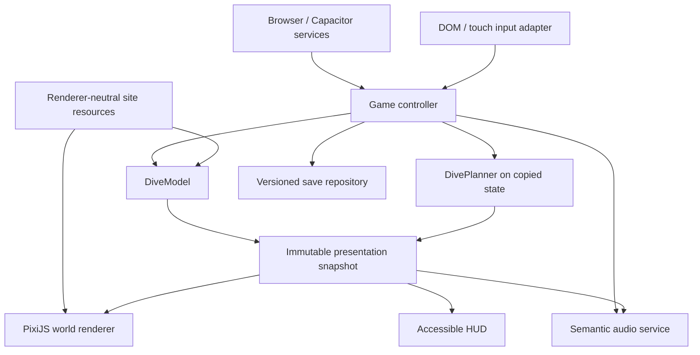

# Implementation decisions

This document records the decisions that govern the 2.5D migration. It is
normative: implementation issues and pull requests must follow it unless a
later committed decision explicitly supersedes a section.

## Delivery model

- Use an incremental strangler migration.
- Keep the current HTML/Canvas client runnable and deployable as the reference
  client until the release work package retires it.
- Keep authoritative simulation changes separate from renderer changes.
- Require an independently reviewed fixture change for every intentional model
  correction. Never update expected values only to make a test pass.
- Treat each work package as an epic made up of dependency-linked issues small
  enough to review independently.

Issue states are:

- `READY`: dependencies and required inputs exist.
- `BLOCKED_EXTERNAL`: a named person, account, device, credential, review, or
  production asset is missing. Only the affected issue stops.
- `BLOCKED_TECHNICAL`: an executable check disproves the current approach.
- `ACCEPTED`: every command and item of required evidence passes.

## Locked product decisions

| Area | Decision |
| --- | --- |
| Product | A fictional 2.5D diving simulation in Games / Simulation. It is not training, certification, medical guidance, a dive computer, or a real-dive planning tool. |
| Release scope | The intended first release territories are the United States and Germany, with English and German as release-blocking locales. EU trader disclosure conflicts with minimal public identity exposure and must be resolved before production identity or store records are created. |
| Platforms | Android 10 / API 29 or newer and iOS 16 or newer. Mobile supports portrait and landscape, touch, safe rotation, and pause/re-layout. Web supports keyboard. Controller support is deferred. |
| Android target API | `targetSdk` is not pinned this early. Record the Google Play requirement and verification date when the native project is created, and re-check it immediately before every submission. |
| Browsers | The latest two major Chrome, Edge, Firefox, and Safari releases. CI exercises Chromium, Firefox, and WebKit. |
| Commerce | None. No advertising, purchase, subscription, entitlement, consent-management SDK, or unlock path exists in the client. |
| Telemetry | No product analytics, advertising identifier, fingerprinting, or third-party crash/performance telemetry SDK. Diagnostic export is explicitly user initiated. |
| Saves | Local, versioned saves only. Accounts, cloud saves, and cross-device synchronization are out of scope. |
| PWA | Installation is deferred. |
| Beta exit | Complete scenario/device evidence, a 14-day private-beta soak, at least 99.5% crash-free sessions where aggregate store diagnostics are available, no reproducible release-blocking lifecycle defect, zero unresolved Critical or High safety findings, and manual product-owner approval. |

The public display name, publisher identity, production application IDs, final
logo, and trademark position are undecided. Internal native builds may use the
temporary identifier `monster.gorman.scuba.divingsimulator.dev` and clearly
development-only branding. Production records and signing must not use them.

## Safety and claims

- Show a concise simulation-only use boundary in the current web client during
  the baseline work package; do not wait for store hardening.
- Maintain a versioned claims register covering numerical, decompression,
  medical, training, prevention, warning, help, screenshot, website, and store
  statements.
- Seed the register from `docs/research/`, but re-anchor the existing algorithm
  audit to current source files before treating it as evidence.
- Require first-run acknowledgement and an always-accessible Safety and
  Methodology screen before public distribution.
- Keep `SIMULATION` visible wherever a screen could be mistaken for a real dive
  computer or exported plan.
- A qualified diving-domain review and territory-specific legal review are
  external public-release gates. Engineering must not represent either as
  complete without the dated acceptance artifacts.

## Architecture

`game-controller.ts` is the composition root. Platform adapters provide
services to the controller; the controller owns simulation, save, planner,
snapshot, audio, and render coordination.

`DiveModel`, `DivePlanner`, site schemas, trace fixtures, and save migrations
must not import PixiJS, DOM APIs, or Capacitor. Input adapters emit intents and
must not mutate model fields directly. Rendering consumes immutable
presentation snapshots.

`DiveModel` advances in two ways (owner decision on #192, 2026-09-30).
`advance()` takes a dictated depth and integrates in fixed one-second steps.
`advanceWithBuoyancy()` lets the buoyancy physics move the diver and advances
exactly one display frame per call, of the length the controller passes,
capped as legacy's `gameLoop()` caps it. Legacy applies the BCD controls once
per frame and sub-steps only the physics within it, so the frame boundaries are
part of its behaviour; a fixed step would match legacy at one frame rate only.

The save holds two parts, each with one owner (#137 A4b, save version 21).
`DiveState` is the model's; the session (`SessionSnapshot`,
`src/save/session-snapshot.ts`) is the controller's: the route position, the
way the diver faces and the torch. Depth is the model's alone:
`DiveState.depthM` is the last step the model took, and since the model steps
once per display frame the diver is drawn at that depth, so there is no view or
controlled depth between steps and the session carries none. On restore the
state's depth decides the session's position, never the reverse: a position
the depth rules out goes back to the route's start, and only a save with no
position the depth allows has its depth moved, explicitly, to the start's
floor (`withinRoute`, #206). The controller's real time (`elapsedRealS`) is not
saved: it times only the scene's animation, the breath and bubble sounds'
cadence and the forecast's age, and a resumed dive starts it at 0. Held controls and the fast-forward are not saved,
so nothing is held after a restore.

## Engineering defaults

### Accessibility and localization

- Target WCAG 2.2 AA. Success Criterion 2.5.8 has a 24 by 24 CSS pixel minimum;
  this product additionally adopts 44 by 44 CSS pixels as its internal touch
  target standard.
- Provide visible keyboard focus, DOM/native labels for critical controls and
  status, live warning text, reduced-motion support, and text scaling.
- Do not encode meaning only through color, motion, or sound.
- Establish a string catalogue and locale-aware depth, pressure, duration, and
  gas-fraction formatting with the dual-client toolchain. New TypeScript
  modules must not introduce literal user-facing strings outside the catalogue.
  Translation and review remain part of product hardening.
- The dive computer reads English in every locale, its warnings included
  (owner decision on #232, 2026-10-07): a dive computer is a device with one
  display language, and legacy draws its own in English in both languages.
  This is a deliberate exception to German as a release-blocking locale. It
  covers the in-dive HUD readouts (depth, time, NDL, the gas and rebreather
  rows, the ascent rate), the stop row, the rule-of-thirds gauge, the warning
  alert and the status chip's warnings, and the gas-information pages, with
  their numbers formatted in English too. The strings live in the catalogue's
  `diveComputer.*` namespace, which has no German table, and the elements that
  show them carry `lang="en"` so assistive technology speaks them as English.
  Everything else stays localised: the SIMULATION boundary and the safety
  gate, the setup, post-dive and game-over screens, the controls and their
  accessible names, the surface prompt, the location row and the status
  chip's "Simulation running".

### Performance evidence

- Use at least 300 warmed samples per named scene and device for each run.
- Record sample count, minimum, median, p95, p99, maximum, long-frame count,
  and total time above 16.67 ms per 1,000 frames.
- Compare three independent runs on the same device and build.
- Accept a Canvas stabilization only when the selected primary metric improves
  by the issue's threshold and no reported metric regresses by more than 5%.
- Preserve an isolated rollback path and prove authoritative traces do not
  change.
- Desktop emulation is diagnostic evidence, not physical-device acceptance.
- WP-01 desktop Canvas evidence is a relative hotspot ranking, not an absolute
  frame-time gate. Before/after measurements must run back to back in the same
  session because unchanged renderer captures have shifted roughly 3x between
  sessions.
- `artifacts/wp-01b/desktop-reference/before.json` (`sourceCommit: bcee12e`,
  generated by `node scripts/compare-performance.mjs`) used the pre-fix
  harness. Recapture it before evaluating WP-01B's "p95 improves >=20%" gate;
  the existing WP-01B artifact cannot establish that gate. Resolved for WP-01B
  under session `wp01b-20260802-guarded-tip`; the same recapture is still owed
  by any other work package whose evidence predates the same-session rule.
- Report a stabilization result as a magnitude, not a precise percentage. The
  gate divides by whatever the session's before value happened to be, and the
  same unoptimized wreck renderer has measured 37-38 ms, 46-50 ms, and 224 ms
  medians across three sessions on one machine. Quote the budget outcome
  (long frames per 300) alongside any percentage.
- Diagnostics probes are an optional observer everywhere, not only in
  `game-loop.js`. Any file that adds a named pass must resolve the collector
  through a guard, and `renderer.js` must resolve it lazily because it is
  parsed before `diagnostics.js`. A regression test for this must assert that
  the frame loop keeps advancing, not merely that `gameState` reached
  `diving`: `updateSurface()` sets that before `drawScene()` ever runs, so a
  client frozen by a render-pass throw otherwise passes.

### Trace contract limits

- **Closed in #156.** Each checkpoint now carries a `trajectory`: the depth and
  duration of every `updateDiving()` tick since the previous checkpoint. The
  recorded depth is the one read back *after* the tick, because
  `updateBuoyancyPhysics()` moves `depth` and the result is clamped before
  `updateTissues()` reads it, and nothing assigns `depth` in between — so the
  value left after the tick is the one the tissues integrated at. Replaying that
  sequence reproduces ascent-reached checkpoints at the declared 1e-9 tolerance;
  `tests/parity/tissue-model.test.ts` asserts the air, trimix and CCR ascents.
  The pure suite no longer depends on the legacy client to prove dynamic-depth
  parity, which is what the WP-12 cutover needs.
- The history, because it explains the shape of the fixture: the trace recorded
  depth only at checkpoints. A pure model reproduced every static-depth
  checkpoint exactly, but no depth schedule derivable from the fixture
  reproduced a checkpoint reached through an ascent — the nominal 12 m/min ramp
  landed about 1.2e-3 bar out and a midpoint-depth replay about 1.0e-3, against
  a tolerance of 1e-9. The legacy client integrates at depths the ramp never
  visits, and the fixture did not record them.
- A checkpoint's `state.depth_m` is not the last trajectory depth. `ascend()`
  and `holdDepth()` call `setDepth()` after their loops without a tick, so the
  recorded position can differ from the last integrated depth by ~0.1 m. The
  trajectory is the record of what the tissues saw; replay it for tissue parity
  and do not assert the final depth from it.
- Do not close a gap of this kind by widening a tolerance or regenerating
  expected values.
- The same class of gap applies to latched planner state. `ndlDroppedBelow5` is
  set in `updateDiving()` *after* `calculateTTS()` has already run for that
  tick, so a checkpoint can record NDL 3 with the latch still false, or NDL 15
  with it already true. It widens the safety stop from 3 to 5 minutes, so it
  changes TTS. It is now recorded in the checkpoint rather than reconstructed;
  reconstructing it from recorded NDL is provably wrong in both directions.
- When a pure module needs a legacy input the trace does not record, add the
  field to `captureBaselineCheckpoint()` and regenerate. Verify the regeneration
  is additive by confirming the numerical payload is unchanged.

### Visual comparison

- `scripts/compare-rendering.mjs` compares two source trees with a seeded,
  clock-pinned, fixed-state DPR-1 pixel capture. It enforces a per-scene budget
  of 32 maximum channel delta and 0.5/255 mean, and exits non-zero on a breach,
  so it can gate a build rather than only inform a reader.
- Those thresholds sit at roughly twice the drift measured when snapshot/restore
  compositing was replaced with transparent overlays (wreck 18 max / 0.076 mean,
  cave 7 / 0.009). Raise one only with a recorded reason: widening a threshold
  to make a run pass is how a visual regression ships.
- Seeding `Math.random` alone was not enough to make this deterministic. Parts of
  the wreck scene animate on the wall clock, so `Date.now` is pinned too.
  Without that, comparing a tree against *itself* returned a 180 channel delta
  across 1.9% of pixels on roughly one run in three — noise far above the
  budget, which would have made the gate meaningless.
- The comparison covers two scenes at fixed camera positions. A change outside
  those views is invisible to it, so it bounds visual regression rather than
  proving its absence.
- Guard-scene drift is expected at this scale and is not a regression signal on
  its own. The WP-01B bounded-overlay change moved reef render medians by up to
  +31% while the absolute delta stayed at or below 0.5 ms, on a code path that
  strictly removed work. Judge guard scenes by absolute milliseconds, not
  percent.

### Security and deployment

- Commit schemas and inert placeholders only. Keep application IDs and signing
  material in protected environments.
- Never print or archive keystores, keys, certificates, provisioning data,
  store credentials, or review secrets.
- Verify the deployed Content Security Policy when introducing Workers,
  generated blob URLs, WebAssembly, or renderer changes. Local development
  success is insufficient.
- Build the web application once, test those exact bytes, record their SHA-256,
  and deploy that artifact. A deployment job must not rewrite or delete files
  after the artifact has passed its release checks.
- Keep application deployment separate from Terraform provider/state changes.
- Web rollback redeploys the previous verified artifact. Mobile rollback halts
  staged rollout; save migrations remain forward compatible.

### CI and evidence

The target pull-request checks are Node 22 install, type-check, lint, dependency
license checks, unit/parity tests, Chromium/Firefox/WebKit browser tests, a
production web build, and an Android debug build once native projects exist.
An unsigned iOS compile is required once the named macOS/Xcode environment is
available; until then it remains `BLOCKED_EXTERNAL`.

Machine-readable evidence belongs under
`artifacts/<work-package>/<issue-id>/`. JSON evidence records the source commit,
build identifier, command, timestamp, environment, and relevant device/browser
metadata. Binary evidence has a JSON index with its SHA-256.

## Legacy test harness

`src/diving-simulator-tests.html` remains the legacy behavioral oracle until
the release work package retires the reference client. Assertions move
incrementally into Vitest and parity fixtures during the core, planner, and save
work packages. The harness may be retired only when every retained behavior has
an owned replacement test or an explicitly reviewed disposition.

### Deliberate departures from the legacy client

The legacy client is the behavioural oracle. The migration client departs
from it only where a decision is recorded here. Each departure keeps the
legacy client and its fixture unchanged. A parity test names the checkpoints
it affects, compares everything else there with legacy, and asserts that the
departing values differ from legacy and match an independent reference.

| Decision | Legacy behaviour | Migration behaviour | Evidence |
| --- | --- | --- | --- |
| #160, 2026-10-15 (PR 1 of #160, the help overlay) | Keys go on landing in `keys[]` behind the open help overlay (`src/state.js` keydown). In 'surface' `updateSurface()` runs whatever `showHelp` is, so S begins the dive behind the overlay; in 'diving' a key held through it acts once it closes, when `updateDiving()` reads `keys[]` again; on the debriefing Enter waits for it to close (`src/game-loop.js` gameLoop). | The open overlay takes every key press but Escape, which also closes the gas information as legacy's does: no press reaches the dive or the screen until it is closed (`src/app/help-overlay.ts`). Key releases still reach the dive, as legacy's keyup always clears its key. Under water the dive stands still while it is open, as legacy's, its held controls are let go, and the last frame is repeated so a warning goes on beeping, as legacy's `drawDiveComputer()` goes on calling `playAlertBeep()` (`GameController.setPaused`). | No parity checkpoint records the help overlay. `tests/help-overlay.spec.js` ("at the surface it leads with S, S pressed behind it does not begin the dive, and a key let go behind it is let go", "under water H opens it and stops the dive; Escape, ?, H and Enter on Close work it"); `tests/unit/game-controller-surface.test.ts` ("the dive paused under the help overlay (#160) …") |
| #160, 2026-10-17 (PR 2 of #160, the onboarding hints) | The help overlay always ends in "Don’t show hints again" (`src/state.js` showHtmlHelp, #38). A press sets `diveSim_hintsDone` and drops the hint showing, and nothing on screen changes: the button stays, and pressing it again does nothing. | The button is offered only while the hints are on: a press stops them as legacy’s does, takes the button away and returns focus to Close, so a keyboard or screen-reader user knows it took (`src/app/help-overlay.ts`). Once dismissed, in either client, the help offers no button. The hints themselves, their triggers, their 6 s, their queue and legacy’s storage keys, are legacy’s (`src/app/onboarding-hints.ts`). | No parity checkpoint records the hints or the help overlay. `tests/onboarding-hints.spec.js` ("by keyboard: … then dismissed for good", "by touch, in German, on a phone …"); `src/app/onboarding-hints.test.ts` (TC-38-DISMISS-SURVIVES-RESETDIVE) |
| #160, 2026-10-23 (the training drills' core, pre-review pass 1 of #270; the outcome logged and drawn, 2026-10-24) | `resolveDrillOption()` pushes `{ t, kind: 'drillOutcome', value: { id, option, correct } }` to `diveEvents` (`src/game-loop.js`), which the save keeps and the debriefing's profile draws as a red dot at that time, at the depth of the nearest profile sample, as it draws every event (`drawDiveProfileChart`, `src/renderer.js`). `gradeDive()` reads only the fast ascents and ceiling violations among them (`src/physics.js`). Legacy's debriefing has no list of the events. | The outcome is logged as legacy logs it: after the option's effect, `applyDrillEffect()` (`src/core/drills.ts`) has the model add a `drill-outcome` entry to its dive log (`recordDrillOutcome`, `src/core/dive-model.ts`), at the dive time the drill stopped the dive at, with the drill, the option's place among those offered and its verdict. Save version 20 keeps it (`src/save/save-game.ts`); older saves never logged one, and a legacy save's `drillOutcome` is kept where the model could have logged it on that dive, which drops the cave's lightFailure (#167). The post-dive profile draws it as legacy's red dot, at its time and the nearest sample's depth (`src/app/profile-chart.ts`). What still departs: the violations list is the text equivalent of the profile's numbered markers (#159), and a drill is not a violation, so its dot is unnumbered and ringed in white, keyed "Training drill" in the legend, and the chart's text alternative names the drill, its time and its verdict in legacy's words. The violations list and the grade leave it out, as `gradeDive()` does. | No recorded dive has a drill. `tests/parity/drills.test.ts` ("resolves as legacy", TC-45-DIVE-EVENT-LOGGED): for every option on one, two and three cylinders and the rebreather, legacy pushes exactly one `drillOutcome` and the model's log gains the same entry at the same dive time. `tests/unit/save-game.test.ts` ("the drill's outcome in the log"), `tests/unit/post-dive-summary.test.ts` (violations and grade as without the drill), `tests/unit/profile-chart.test.ts`, `tests/unit/game-controller-drills.test.ts`, `tests/drills.spec.js` ("the drill's outcome is legacy's dot on the post-dive profile …"). |
| #160, 2026-10-23 (the instructor panel of #46, under #160) | `drawInstructorOverlay()` paints six rows on the canvas at the left edge, 12% down (`src/renderer.js`). The third annotates the newest exhaled bubble with its growth since exhaling, from the model's `bubbles[]` and `bubbleDisplayRadius()` (`src/world.js`). Its values "% since exhale", "% of M-value" and "MOD … m \| END … m \| N …%" are English literals in both languages; its MOD and gas consumption read `activeGas()`, which on an active loop is `tanks[0]`, the setup placeholder (#183, #192), and the MOD of a 0 % O₂ mix divides by zero; the tissue's caution, danger and the MOD's warn tones are colour alone; L toggles on every keydown, with Ctrl or Alt held and on a held key's repeats (`src/state.js` keydown). | Five rows, as DOM, where the camera never draws the diver mid-route (it leads the diver by 8 of its 58 m, so the diver is at 0.362 or 0.638 of the stage, not legacy's centre): at the stage's right where it is wider than 720 px and taller than 600, at most 32.5 % of the side less 1 rem wide; on a phone in portrait below the diver's deepest line (34 m) and below the HUD. On a short screen (#256) it stays under the two-column HUD and is over the diver mid-route at 11–29 m (844×390) and about 10–27 m depending on the HUD's height (667×375). Two cases remain, tracked in #271: at the route's stern, where the camera holds its focus within 29–87 m, the diver drifts to 0.828 of the stage at x 106 and is under the wide-screen panel at every depth 0–31 m, either way it faces, from x 102–103 at 1280×720, x 103 at 1366×768 and 1440×900, x 105 at 1920×1080 and x 98 at 800×700; and on a rebreather at 340–375 px the 403 px CCR HUD leaves the portrait panel about 20–24 px tall (24 px at 340×640 and 360×640, its heading half visible; about 20 px of content at 375×667), where a recreational dive has 71 px at 360×640. Its button stands at the HUD's top right, as the topbar has no room on a narrow phone (#259) and the dock none on a rebreather's; any finger presses it, as the touch context group's (#168). Neither L nor the button acts, and the panel is hidden, while a drill's decision or debriefing stops the dive: legacy's 'drill' state, in which its keydown and drawScene() require 'diving'. The bubble row waits for bubbles the model emits (#162): this client's are drawn by the renderer alone. The values are in the catalogue in both languages, on an active loop the MOD and the consumption show — rather than the placeholder's, as #183 and #192 keep it from what the diver sees (bailed out, the diluent's, as legacy's), a 0 % mix shows no MOD (—), the danger and warn tones carry ⚠ and the caution tone a hidden word, as the gas page's, and L toggles once per press, unmodified but for Shift. The other rows are legacy's formulas on the model's state (`src/presentation/instructor-physics.ts`, `src/core/gas-physics.ts`). | No parity checkpoint records the panel. `tests/unit/instructor-panel.test.ts` (TC-46-*), `tests/instructor-panel.spec.js` |
| #160, 2026-10-24 (the training drills' client, after #270) | `drawDrillOverlay()` labels each row by its place among the options offered, `strs.options[i]` (`src/renderer.js`), while `resolveDrillOption(i)` acts on the i-th option offered: on a dive with one cylinder the backup is not offered, so the free-flow drill's second row reads "Switch to your backup tank" and holds the diver's breath, marked wrong. Keys pressed during a drill land in `keys[]` (`src/state.js` keydown): a movement key held through it acts once it ends, and H sets `showHelp`, which opens the help then. The debriefing's 5 s are wall-clock time (`_drillRealTime()`), so they run on while the page is hidden; any tap on the canvas, on the card too, ends it. | Each row reads its own option (`src/app/drill-overlay.ts`). The drill's dialog takes every key press but its own, 1 / 2 / 3 and Enter, as the help overlay does, and lets go of the controls held when it starts (`GameController`); key releases still reach the dive. The debriefing's 5 s are the frames' real seconds, as the hints' are, so a hidden page does not spend them; a tap outside the card or on Continue ends it. The outcome is logged and drawn on the post-dive profile; see the row above. The gates, the roll, the pick, the options and their effects are legacy's. | No recorded dive has a drill (`scripts/baseline-scenarios.cjs` turns them off). `tests/parity/drills.test.ts` runs legacy's own `isDrillEligibleNow()`, `_pickEligibleDrill()`, `startDrill()` and `resolveDrillOption()` against the module over the states the wreck meets, and its strings word for word. `tests/drills.spec.js` ("by keyboard: … each announced once" reads the two options of a one-cylinder dive; Escape and H do nothing under the dialog); `tests/unit/game-controller-drills.test.ts` |
| #160, 2026-10-24 (saving a drill under way, after #272) | `saveDiveState()` saves `drillHasRunThisDive` and `drillState` with the debriefing's real seconds left, and `restoreDiveState()` restores them (`src/game-loop.js`). `_isValidSaveState()` refuses the whole save, and `loadSavedDive()` clears it, when any drill field is missing or malformed, the id is unknown in a drill's phase, a phase does not go with `gameState` ('drill' only with the decision or debriefing, 'surface' only with none), or the free-flowing cylinder does not agree with the free-flow's end or is not one of the dive's. It accepts the cave drill's flicker, lightFailure, under 'diving'. | Save version 19 holds the drill under way (`drill`, `src/save/save-game.ts`), and a dive resumed from it resumes the drill: its decision or debriefing up again with the seconds it had left, its free-flow or held breath running on, and the run kept, so no second drill comes (`initialDrill` in `src/app/game-controller.ts`). The controller hands the drill to the autosave with every state, and on the frames a drill stops the dive, as legacy's autosave runs in 'drill'. A legacy save's drill is kept under the same checks. Where legacy refuses the save, the dive is kept and only the drill is dropped, run if the record says so (`resumedDrill` in `src/core/drills.ts`), as a position off the route is (#222 row). Two checks are added: a drill under way needs the 3 dive minutes one can start at, and the debriefing at most its 5 s. Legacy's lightFailure and its flicker resume with none under way, run, as the cave is #167. Saves before v19 resume with none under way and none run: exact for v1 to v17, whose clients had no drills, and for a v18 save of #272's client the behaviour it had, a drill able to come again, as legacy's v1 saves restored. | No recorded dive has a drill. `tests/parity/drills.test.ts` ("a drill under way saved and resumed as legacy's save and restore") runs the drill's lines of legacy's `saveDiveState()`, `restoreDiveState()` and `_isValidSaveState()` from its source: the decision, the debriefing 2 s in and the effect after it of every option on one and two cylinders and the rebreather are saved as legacy saves them, by the migration's save and by a legacy import, and answered after the restore as legacy's (TC-45-66-DRILL-OVERLAY-SURVIVES-RESUME, -DRILL-EFFECT-TIMERS-SURVIVE-RESUME); legacy's TC-45-66-VALIDATOR payloads resume what legacy restores, or the dive with none under way where legacy refuses it; the genuine flicker is the named departure. `tests/unit/save-game.test.ts` ("the drill under way"), `tests/unit/game-controller-drills.test.ts` ("a drill under way, saved and resumed"), `tests/drills.spec.js` ("reloaded at its decision …") |
| #168, 2026-10-23 (PR 2 of #168, the touch context group) | The context group (`#touch-dive`, `src/touch.js`) is pressed on `touchstart`, by every finger, at once, with no way to take a press back: a finger that slides off bailout has bailed out. Its fast-forward button shows only while the diver is also stationary, `Math.abs(ascentRate) < 0.5` (`touchUpdateUI()`), though F works without it (`src/game-loop.js` updateDiving). On a touch screen help, info, fast-forward and torch or bailout stand in a column on the right, the setpoint buttons above the pad on the left and the cylinders centred above the pad; on a desktop the group shows only on a rebreather dive, while the loop is breathed: `updateCcrDiveButtonVisibility()` shows the whole `#touch-dive` group and `touchUpdateUI()` returns before hiding any of it (`src/touch.js` 249), so beside the setpoint and bailout buttons `H` Help and `L` LEARN show too (`src/diving-simulator.html` 25, 27), bound to `touchstart` alone, so a mouse cannot press them. Each face is its key and a word: `H` Help, `I` Info, `F` x10, `T` TORCH, `B` Bailout, `T1` to `T6`. Learn (`L`) sits beside Help; drills take their options as taps on the canvas. | A finger presses a control when it is lifted over it, the first finger or any other, so a thumb can hold the D-pad meanwhile; a finger lifted elsewhere, or a touch the browser cancels, presses nothing, as a click is not sent for a tap that left its button. A mouse and the keyboard press by click (`src/app/touch-press.ts`). Fast-forward is offered whenever F works, so a touch reaches what the key reaches. Help and gas information sit in the topbar, the torch and fast-forward in the pad's two empty cells, the cylinders and the rebreather row in the dock at the bottom left, on every device (#163, #255, #257). The faces are symbols and digits (◉, », i, ?, 1 to 6, SP −, SP +, Bailout); each control is named by its action and its key (`aria-keyshortcuts`), and the help overlay lists each face beside its key. Learn, the instructor panel's L, is pressed the same way; it and the drills are recorded in the #160 rows above. | No parity checkpoint records the touch controls. `tests/touch-context.spec.js` ("a second finger, with a thumb on the D-pad …", which fail on main's click-only presses; "a tap presses once; a touch slid off or cancelled presses nothing"; the geometry at 390×844, 360×640 and 1280×720); `tests/unit/touch-press.test.ts`; `tests/in-dive-controls.spec.js` ("fast-forward") |
| #168, 2026-10-24 (PR 3 of #168, the visibility rules per state and mode) | `updateCcrDiveButtonVisibility()`, `updateNavPadVisibility()` and `touchUpdateUI()` (`src/touch.js` 200–324) hide every control of the dive, the pad, the `#touch-dive` group and the loop's buttons, while the help is open (`showHelp`, 209, 236, 254) and outside `gameState === 'diving'`, so also through a drill's decision and debriefing, the 'drill' state (`src/game-loop.js` 152, 204). At the surface a touch screen shows one Descend button, S (311–313, 186), and a desktop nothing, though H opens the help there (`src/state.js` 164); on the debriefing, where H opens it too (`src/game-loop.js` 1252), a touch screen shows Dive again alone (319–321). They hide on `showGasInfo`, which nothing sets (`src/state.js` 479), and never read `infoPageMode`, so the page I opens hides nothing. | The help and a drill's decision and debriefing are modal dialogs: the controls stay drawn under the backdrop, inert, so neither focus nor a finger reaches them, nothing moves under a thumb as the dialog closes, and focus returns to the control that opened it (`src/app/help-overlay.ts`, `src/app/drill-overlay.ts`). Learn is hidden under a drill, as L does nothing there (#160). At the surface the pad shows ↓, the S button, and the topbar Help and mute, on every device; the debriefing has Help beside Dive again; so a touch reaches what H reaches. The gas page hides nothing, as legacy's (#255 pre-review pass 4). Everything else follows legacy's states: 'diving' is the dive begun and not ended, at any depth, and Info is offered there at every depth, where it was hidden under 0.5 m (`gasInfoAvailable`, `src/app/gas-info-pages.ts`). Mute and the fast-forward chip have no legacy counterpart. The desktop's set and fast-forward's stationary condition are in the PR 2 row above. | No parity checkpoint records the touch controls. `tests/control-visibility.spec.js` walks the setup, the surface, under water, back at 0 m, a stop, fast-forward running, the gas page, the help, a drill's decision and debriefing, bailed out, the game over and the debriefing, in rec, tec and ccr, on a phone (390×844, touch) and a desktop (1280×720), against a table of legacy's sets with their lines and these departures; its 0 m case fails with the gate before this PR. `tests/unit/gas-info.test.ts` ("a dive under way has them at any depth …") |
| #137 A5 and A9, 2026-10-24 (the web half of pause/resume and the wake lock) | Legacy does nothing when the page is hidden: no `visibilitychange`, `freeze` or `blur` handler (`src/game-loop.js`, `src/state.js`). The browser stops its `requestAnimationFrame` loop, so the dive stands still while hidden, but it is saved only by the loop's 3 s autosave and guarded by a `beforeunload` prompt (`maybeSaveDiveState()`, `updateBeforeUnloadGuard()`), neither of which a phone that discards a background page runs. On return the first frame's `dtReal` is clamped to 0.1 s (`gameLoop()`), so it runs 0.1 s times the time acceleration (`TIME_ACCELERATION` = 3, `src/constants.js` 27; `src/game-loop.js` 272): 0.3 s of the dive, or 3 s under fast-forward. A key or touch held as the page went stays in `keys[]` until its keyup arrives, and a hidden page may never receive it. It asks for no screen wake lock. | Hidden or frozen, the dive is saved at once by the save `pagehide` writes, a drill under way included (#273), then held paused with nothing more handed to the autosave, its held keys and D-pad directions let go, its sound suspended and its wake lock released; visible again, the first frame runs no time and the lock is asked for again. A dive that finishes loading on a page already hidden starts in the background, as if it had gone there after (`watchPageLifecycle` and `ScreenWakeLock` in `src/app/lifecycle.ts`, wired in `src/app/wreck-app.ts`). The help overlay and the background each hold the dive by their own reason, and the dive runs only when neither does, so coming back does not lift the help's pause nor closing the help the background's (`GameController.setPaused(reason, paused)`); a drill's stop is the drill's own state and outlasts both. The screen is kept on while the dive screen is up and the page visible, from the surface wait to the end of the dive; where the API is missing or the request is refused, nothing happens and nothing is logged. The native lifecycle service (A0) and the process-death test (A5b) are not part of this. | No parity checkpoint records a hidden page. `tests/page-lifecycle.spec.js` (hidden: a save written as it goes, no dive time across an autosave interval, then the dive runs on; the help open across a hide and a show; a D-pad direction and D held as it goes; the wake lock's requests and releases, against a recording API; a dive started on a hidden page: saved, paused, silent, no wake lock, then running once shown); `tests/unit/game-controller-pause.test.ts` (the help, the background and a drill interleaved); `tests/unit/lifecycle.test.ts` |
| #191, 2026-10-10 (pre-review pass 1 of #250) | The resume strip (`#resume-dive-banner`) is updated only at load and by its own Resume and Discard (`_updateResumeBanner()`, `src/game-loop.js` 1742–1773 and 1960–1966). Enter on the gas setup starts a new dive and leaves the strip drawn over it, and Resume there runs `restoreDiveState()` on the in-memory save over the dive under way. | Start on the setup screen ends the offer with the screen: the new dive shows no banner and offers no resume, and its first autosave replaces the old save in storage, as legacy's does (`showSetupScreen` in `src/app/wreck-app.ts`). | No parity checkpoint records the gas setup or the strip. `tests/resume-flow.spec.js` ("Start with the banner up ends the offer …"): over the new dive there is no banner and no Resume button, before and after its save replaces the old one. |
| #220, owner, 2026-10-07 | Narcosis grays the scene above index 0.4 (`grayscale(min(80, (index - 0.4) * 133)%)`) and blurs it above 0.5 (`blur(min(3, (index - 0.5) * 6)px)`): canvas 2D `ctx.filter` passes over the whole scene every frame (`src/renderer.js` drawScene, WP-020), which made performance collapse. | Neither is drawn. The other effects below the KO are ported: swallowed inputs above 0.3 and the vertical drift above 0.45 in the model, on the dive's seeded random state (`src/core/narcosis-effects.ts`); the tunnel vision above 0.15, one overlay sprite drawn once per viewport size whose alpha follows the index, and the wobble above 0.25, an offset of the world container that `prefers-reduced-motion` turns off (`src/render/narcosis-view.ts`, `src/render/pixi-renderer.ts`). | `tests/parity/nitrogen-narcosis.test.ts` ("narcosis on the view against the recorded legacy dives"): five checkpoints of `narcosis-air-65m` reach the departure, and the test names them with the filter legacy sets there, written out from `src/renderer.js` and checked against it: `bottom-4min` `grayscale(71%) blur(2.6px)`, `ko-counting` `grayscale(74%) blur(2.7px)`, `ascended-45m` `grayscale(65%) blur(2.3px)`, `back-60s` `grayscale(72%) blur(2.6px)`, `narcosis` `grayscale(74%) blur(2.8px)`. There the migration sets no filter, and its vignette alpha and wobble amplitude match legacy's. Every other recorded checkpoint stays at index 0.4 or below, where legacy sets none, and the test asserts it. The filters are render-only, so no model value departs: the same file compares the index they read with legacy at every checkpoint of `narcosis-air-65m` and of eight other recordings. `tests/unit/narcosis-view.test.ts` ("narcosis on the view"); the Pixi visual check's `wreck-narcosis` scene. The game-over prevention text names only the cues the migration shows (`gameOver.info.nitrogenNarcosis.prevention3`, claims register NARCOSIS-001) |
| #219, owner, 2026-10-07 | Legacy centres the diver (`DIVER_SCREEN_X_FRACTION` 0.5), so its shark spawns 100 px and leaves 150 px beyond the edges of a view centred on the diver (`src/game-loop.js`, TASK-043). | The wreck camera leads the diver by 8 m in the direction they face and is held inside the scene's bounds, so the shark spawns 5 m and leaves 7.5 m beyond the edges of the view the camera shows, which need not be equally far from the diver (`wreckViewAround` in `src/render/camera.ts`; `viewLeftM` and `viewRightM` of `SharkFrame` in `src/core/dive-model.ts`). | `tests/parity/shark-encounter.test.ts`: the only recorded checkpoints with a shark are `shark-encounter-5m`'s `spawned`, `contact-survived`, `second-spawn` and `shark-attack`, on the reef, and the test asserts that no other checkpoint has one. On legacy's centred 1000 px view, 25 m to either edge, it compares every checkpoint with legacy. On the camera's mid-route view, written in the test as 29 - 8 m behind and 29 + 8 m ahead, it asserts the departing values at named checkpoints, everything else being legacy's. `surface` and `three-rolls` are unaffected. At `spawned` and `second-spawn` the shark is 4 m nearer. At `contact-survived` it is 7 m past the diver, not 0. At `gone` it is still swimming at 43 m, short of 44.5 m. In `shark-attack` the attack lands on tick 3 of 5, not tick 5. `tests/unit/shark-encounter.test.ts` ("spawns and leaves beyond each edge of a view that is not centred on the diver"), `src/render/camera.test.ts` ("the wreck camera's view around the diver"), `tests/unit/game-controller-shark.test.ts` |
| #219, owner, 2026-10-10 | The shark's floor guard reads `floorAt(shark.x)`, on the wreck its seabed at 66 m (`src/sites.js`), and the shark swims through the wreck's structures (`src/game-loop.js`, TASK-043). | The shark keeps 0.5 m above the floor of the route's stretch of water where it swims, by its depth: 34 m beside the wreck and past its stern, the bow stem's top, the deck, the hold's floor, the engine block (`floorUnder` in `src/sites/wreck-route.ts`, `SharkFrame.floorAt`). It changes the shark's depth only where the shark is deeper than that: near the structures, and below 33.5 m in open water, where legacy's seabed is at 66 m. | `tests/parity/shark-encounter.test.ts`: no recorded checkpoint is affected, and the test asserts it. The four checkpoints with a shark, named there, hold it at 5 m or shallower, under 0.5 m above the route's shallowest floor (the visor's top, 23 - 3.6 m). Replayed over the route's floors, every checkpoint matches legacy. The route's floors are written in the test as numbers from the drawn wreck and compared with `floorUnder` and with legacy's `floorAt` (66 m at each). It asserts where the depth departs: over the stem, at 24 m where legacy's shark stays at 30 m, and off the bow, at 33.5 m from 40 m. `tests/unit/wreck-route.test.ts` ("the floor under a passing shark"), `tests/unit/shark-encounter.test.ts` ("reads the floor where the shark has swum to") |
| #222, owner, 2026-10-10 | The wreck's engines are site features (`{kind:'engine'}`, `src/sites.js`), drawn but never collided with: `solidAt`, `solidBoxAt` and `solidOverlapArea` read only the structures, so the diver swims through them. | The engine block the migration client draws in its engine room is solid: the route stops a diver who swims into it, and the diver goes over it (`WRECK_ENGINE` and `engineTopAt` in `src/sites/wreck-route.ts`). | `tests/parity/wreck-route.test.ts`: no recorded checkpoint reaches the engine block or the visor; the test names the five wreck scenarios of `baseline-v1.json`, asserts that none of their checkpoints lies at either, and compares wreck-thirds' three in the hold (x 50, 32 m) with legacy. It compares solid with legacy's `solidAt` over x 8..99, legacy open and the migration solid only in the engine block and the visor, both written as numbers in the test. `tests/unit/wreck-route.test.ts` ("is stopped by the engine block the scene draws, and goes over it") |
| #222, owner, 2026-10-10 ("whatever looks better") | The bow visor is a site feature (`{kind:'bowVisor'}`, `src/sites.js`) drawn hinged up over the bow opening (`drawBowVisor`, `src/renderer.js`), never collided with, so the diver passes through it. | The visor is drawn hinged up on the deck's forward edge, x 22 to 23, from 19.4 m down to the deck, clear of the opening, and is solid: the diver goes over it, and never through drawn hull (`WRECK_VISOR` in `src/sites/wreck-route.ts`). | `tests/parity/wreck-route.test.ts`, as for the engine block: no recorded checkpoint reaches the visor or the engine block, and the test asserts it. `tests/unit/wreck-route.test.ts` ("is stopped by the stem below its top, by the deck's edge and by the visor") |
| #222, 2026-10-16 (the issue's route-position item; pre-review pass 1 of #261) | `saveDiveState()` saves `diverX` and `restoreDiveState()` restores it unchecked, `diverX = state.diverX \|\| 0` (`src/game-loop.js` 1571 and 1674), on legacy's own hull (`src/sites.js`): its main deck at 27 to 28 m and its accommodation roof at 22 to 23 m. Of the rule of thirds it saves only the reserve latch (`thirdsReserveHitThisDive`), so a reloaded page restores the dive with `thirdsStartingGas` 0 and `thirdsTurnWarned` false (`src/state.js`): a dive resumed under the overhead plans afresh from the gas left on its next tick, and can warn of the turn again. | The migration's own saves record the route position (`routePositionM`, save version 18, `src/save/save-game.ts`), and a dive resumed from one picks up there, in the same zone and under the same overhead as when it was saved (`initialRoutePositionM` in `src/app/game-controller.ts`), with the rule-of-thirds plan and turn latch it saved (`state.thirds`, since v13). A position is resumed only on the route, 8 to 106 m, where the saved depth is in water; anything else, and every save before v18, resumes at the route's start, x 10 (`resumedRoutePosition` in `src/sites/wreck-route.ts`). A legacy save's `diverX` is not kept: legacy's hull and the route's simplified slice put the deck at other depths, so the same x and depth can be open water in one and under an overhead in the other. Legacy imports resume at x 10, as before v18, until #240 aligns the structure. | `tests/parity/route-resume.test.ts`: legacy's lines are written out and checked against `src/game-loop.js`. Of the 19 recorded wreck checkpoints a save can be taken at, named there, the migration's own save resumes wreck-thirds' `surface`, `outbound-10min`, `turn-20min` and `reserve-28min` at the recorded x 50, under the overhead exactly where legacy recorded `inOverhead`, and the other 15, at legacy's x 0 and x -20, at x 10. A legacy save at each of the 19 resumes at x 10, where legacy restores its diverX. With legacy's `src/sites.js` loaded, the test shows why: at x 30, 25 m legacy has open water and the route an overhead, and at x 100, 25 m the reverse. Under the overhead the resumed dive's next step keeps the recorded 2,400 L plan and its turn latch, where legacy plans from the gas left (1,770, 1,140 and 636 L). `tests/unit/save-game.test.ts` ("the route position"), `tests/unit/game-controller-route-resume.test.ts`, `tests/hud-readouts.spec.js` ("a dive resumed in the cargo hold stays there …") |
| #220, 2026-10-10 (Codex round 1 of #249) | Every frame, `updateDiving` draws `Math.random()` once for each held movement key, W, S, A, D, also when narcosis's drop chance is 0, at index 0.3 or below, where the draw keeps the key (`src/game-loop.js` 389–397). Legacy's random stream is unseeded. | The model draws for a held key only where it can be swallowed, above index 0.3; at 0.3 or below it keeps every held key and draws nothing (`swallowInputs` in `src/core/narcosis-effects.ts`). The keys kept are legacy's. Only the number of draws from the dive's seeded `randomState`, which the shark rolls from (#219), departs: a dive without narcosis reaches the shark's rolls at the same place in its stream however long a key is held, and the pinned e2e seed (`tests/helpers/pinned-seed.cjs`) keeps its shark-free rolls. | `tests/parity/nitrogen-narcosis.test.ts` ("departs from legacy only in the draws it makes at a drop chance of 0"): no recorded checkpoint holds a random state. At every checkpoint of `buoyancy-vent-inflate-12m`, `buoyancy-ccr-inflate-12m` and `barotrauma-runaway-ascent-30m`, the recordings that hold keys, named there, it compares the kept keys with legacy's lines written out in the test and asserts the departing draw count, 3 for legacy's three held keys and 0 for the model. Above 0.3 it asserts the same draws and keys as legacy. `tests/unit/narcosis-effects.test.ts` ("keeps every held key at index 0.3 or below and draws nothing") |
| #192, owner, 2026-09-27 | `inflateBCD()` draws the inflation gas from `tanks[activeTank]`, which on a CCR dive is the setup placeholder the diver does not carry. | On a rebreather the BCD inflates from the diluent cylinder; on open circuit from the active tank, as legacy. | `tests/parity/buoyancy.test.ts` ("inflating on a rebreather", on `buoyancy-ccr-inflate-12m`), `tests/unit/buoyancy.test.ts` ("draws from the diluent on a rebreather") |
| #188, owner, 2026-09-26 | The gas-information `I` cycle caps at page 3 with three cylinders or fewer (`infoPageMode > (tankCount > 3 ? 4 : 3)`, `src/state.js`), so the decompression page (4) is reachable only with four or more cylinders, contrary to its "0..4 cycle" comment. | The decompression page is offered on every technical dive: cylinders, tissues, decompression, closed. | `tests/unit/gas-info.test.ts` (the cycle), `tests/in-dive-controls.spec.js` (two-cylinder dive reaching the page) |
| #183, owner, 2026-09-26 | After a CCR bailout, the decompression forecast plans every ascent step and stop on `tanks[activeTank]`, because `bestGasForDepth()` outside tec mode ignores the diluent. On a CCR dive that cylinder is the setup placeholder, which the diver cannot breathe. | The forecast breathes the diluent while its cylinder has gas, and is out of gas when it is empty. | `tests/parity/dive-planner.test.ts` (`DEPARTURES`, on `ccr-setpoint-bailout-30m`), `tests/unit/bailout-forecast.test.ts` |
| #169, 2026-10-24 (the language switch) | The gas setup offers a Language button, by click and by touch, that flips `currentLang` between en and de and redraws the screen with its settings (`src/ui.js` 403–417; `#touch-setup-lang`, `src/diving-simulator.html` 42, `src/touch.js` 176–180, which acts only in 'gas-setup'). It names the other language in that language, "Sprache" on an English screen and "Language" on a German one (`src/ui.js` 568–569). Nothing else offers it: L under water is the instructor panel (`src/state.js` 194). The choice is never stored, so every load opens in English, `let currentLang = 'en'` (`src/constants.js` 551), and the page's `lang` stays `en` (`src/diving-simulator.html` 2). | The setup screen offers the same button, where legacy's stands, before Start, with legacy's words and the other language's `lang`; it redraws the screen in place, with its settings, its focus on the button and a resume banner still up, and the dive, its screens and the next setup follow (`src/app/setup/setup-screen.ts`). As legacy's, it is offered nowhere else. The choice is kept in the page's storage under `diving-simulator.locale`, `en` or `de`, through the `KeyValueStore` port (`src/app/i18n/locale-preference.ts`), as #169's scope asks: at the next load it wins over the browser's languages, which choose when nothing is stored or the stored value is not one of the two. `document.documentElement.lang` and the title follow the switch (`src/app/wreck-app.ts`). | No parity checkpoint records the gas setup or the language. `tests/locale-switch.spec.js`; `src/app/i18n/locale-preference.test.ts` |
| #137 A0, 2026-10-24 (the platform contracts, and the asynchronous store split from A4a) | Legacy reads and writes `localStorage` where it needs it, synchronously and from the game's own code: the save (`src/game-loop.js` 1581, 1585, 1590) and the hint flags (`src/state.js` 1211–1248). It has no lifecycle, back or wake-lock handling (the A5 and A9 row above). | `bootstrap.ts` assembles one `PlatformServices` (`src/platform/platform-services.ts`) and hands it to the app: an asynchronous `store` whose writes resolve once taken and reject where refused, the shape Capacitor Preferences has; the app's `lifecycle`; a `backNavigation` whose handlers are asked newest first; and a `wakeLock`. The browser's are DOM-based (`src/platform/browser-platform.ts`): `localStorage`, the page's visibility, `freeze` and `resume` (`watchPageLifecycle`), `navigator.wakeLock` (`ScreenWakeLock`), and a back that asks no handler, the tab's history being the browser's, until A6 sets the navigation policy. Nothing below `bootstrap.ts` reads `window.localStorage`, `navigator.wakeLock` or `document.visibilityState`, and nothing outside `src/platform/` may import Capacitor. The save repository, the hint flags and the language switch's choice (#169) stay synchronous: they read the same store through `syncStorage` (`src/platform/platform-services.ts` 25; `src/app/wreck-app.ts` 236, 237, 289), a synchronous view of it read on every use, so a page whose storage is blocked fails where it failed when `wreck-app.ts` read `window.localStorage`, and saves, their timing and their keys are as before. Making them await `store`, with the initial load awaited before the controller is built, writes serialised and a refused write shown, is A4a, which removes `syncStorage`; a native shell has no synchronous store until then. | No parity checkpoint records the platform. `tests/unit/platform-services.test.ts` (the store over a synchronous one, rejecting where blocked or full; the assembly against an in-memory store, a fake document and a recording wake lock, the save written through `syncStorage` read back through `store` and the reverse; the back asking no handler; and a scan of `src/` for direct access outside `src/platform/` and `src/app/lifecycle.ts`); `tests/page-lifecycle.spec.js`, `tests/reload-resume.spec.js`, `tests/resume-flow.spec.js` and `tests/wreck-slice.spec.js` unchanged |
| #137 A4a, 2026-10-29 (the asynchronous persistence contract) | Legacy reads and writes `localStorage` synchronously, so no write overlaps another: the save inside `try { … } catch {}`, silent when it throws (`src/game-loop.js` 1581, 1585), read once at load (`loadSavedDive()`, 1588–1590); the hint flags on every check (`showHintOnce()`, `_hintsAreDismissed()`, `src/state.js` 1210–1229). | The save, the hint flags and the language choice go through the asynchronous `PlatformServices.store` alone, and `syncStorage` is gone (`src/platform/platform-services.ts` 23). The store's contract is the save repository's port, `PersistentStore` (`src/save/save-repository.ts` 29), so the save still imports no platform code (the `no-restricted-imports` rule for `src/save/`); `localStorage`'s shape, `KeyValueStore`, moved to `src/platform/browser-platform.ts`. Everything the app keeps goes through one `serialStore` over the platform's (`src/save/save-repository.ts` 44; `src/app/wreck-app.ts` 249): an operation waits until every one before it has settled, so none overtakes another, whoever made it, the load's repairs and the hint and language write-throughs included. Over it, one `LocalSaveRepository` per app (`src/app/wreck-app.ts` 159–167, 255) puts the autosave, the background's save, `pagehide`'s and the clearing at a dive's end in order (`#enqueue`, `#run`, `src/save/save-repository.ts` 197–236): a write made while another is with the store waits for it, a later one made meanwhile replaces it and reports its outcome to both, so no two writes interleave, the latest state wins, and a clearing made behind a save is the last word. A clearing waits for both its removals to settle, and is not taken if either was refused, before the next write starts (221, #284 Codex round 1: a refused one had let the next save start while the other could still delete it). A write made with nothing pending is handed over inside the call, and the browser's store performs it inside its own (`keyValuePersistentStore`, `src/platform/browser-platform.ts` 55–63), so the save `pagehide` writes is in storage before the handler returns, as before; the contract says so, and that a native store (Capacitor Preferences) need not, which is A5b's. The save is read as the gate is accepted, as before, and is now awaited before the setup screen, and so before any controller, is built (`src/app/wreck-app.ts` 270, 287). The language choice is read once, before the gate is drawn, and written through (`loadLocalePreference`, `src/app/i18n/locale-preference.ts` 36); `renderWreckApplication` resolves once the gate is up. The hint flags are read once as each dive starts, before its controller is built, and written through, so a frame asks the store nothing (`loadHintStore`, `src/app/onboarding-hints.ts` 188; `src/app/wreck-app.ts` 491): a flag set elsewhere during a dive counts from the next dive, not the next check. Without readable storage every hint is admitted and none kept, as legacy's; a flag the store refuses to write is taken back once the refusal arrives, a microtask after legacy would have kept none (204). A refused save still resolves `persisted: false` and nothing shows it, as in legacy and as before; the degraded-persistence notice is #282. | No parity checkpoint records storage. `tests/unit/save-repository.test.ts` ("over an asynchronous store": one write at a time and of those made meanwhile only the latest, against a store whose writes settle when the test says; a clearing behind a save the last word; a refused write reported as not persisted and the next taken one as persisted; a clearing with one removal refused and the other pending holding the next save back until both settle, which then survives; `serialStore` one operation at a time across makers and past a refusal, and a save made during a migrating load landing after its rewrite; an unreachable store a rejected load; the save in the browser's storage before `save()` returns); `tests/unit/platform-services.test.ts` (the browser's store writes and removes inside the call; the save through the store alone, no `syncStorage`); `src/app/onboarding-hints.test.ts`, `src/app/i18n/locale-preference.test.ts`, `tests/unit/game-controller-hints.test.ts` (read once, written through, a refused flag taken back); `tests/persistence.spec.js` (`pagehide` writes the save inside the event; storage blocked by an init script: the gate, the setup, the language switch and the dive still work); `tests/page-lifecycle.spec.js`, `tests/wreck-slice.spec.js`, `tests/resume-flow.spec.js`, `tests/onboarding-hints.spec.js` and `tests/locale-switch.spec.js` unchanged |
| #137 A4b, 2026-10-29 (the session snapshot, save version 21) | `saveDiveState()` saves `diverX`, `horizontalVelocity` and `torchOn` (`src/game-loop.js` 1571, 1572, 1578) and `restoreDiveState()` restores them (1674, 1675, 1680), but not the way the diver faces: that is the renderer's `_diverFacing`, 1 on every page load (`src/renderer.js` 140) and turned only past 0.05 m/s of `horizontalVelocity` (1472–1473). A dive saved facing left and still resumes facing right; one saved finning turns on its first frame. No animation clock, held key or fast-forward (`fastForwardActive`, `src/state.js` 350) is saved. | The save's `session` (`src/save/session-snapshot.ts` 32–61; `src/save/save-game.ts` 175–191, 261) holds the route position, which v18 kept at the top, the facing and the torch, and a dive resumes all three as saved (`src/app/game-controller.ts` 306, 338; `src/app/wreck-app.ts` 575, 815), so a diver saved facing left and still resumes facing left. A legacy save resumes facing the way its first frame would turn it, left past -0.05 m/s of `horizontalVelocity` and right otherwise (`legacyFacing`, `src/save/save-game.ts` 770, 800). It keeps its `torchOn` only where that means the same on the wreck it resumes on: at a site with an overhead, its wreck or cave (`src/sites.js` 284, 619), and not while the cave's lightFailure drill holds the torch off, from its flicker until `lightRestoreAt` (`src/game-loop.js` 150, 291–293), as that drill does not resume here (#167). An open-water, shore or reef save holds legacy's off by default for a site without an overhead (`src/state.js` 1122) and resumes with the torch on, as legacy's wreck starts it (`legacyTorchOn`, `src/save/save-game.ts` 216, 771, 789). Its `diverX` stays dropped (#222). A v18 to v20 save keeps its position and resumes facing right with the torch on, as those clients resumed every dive, and an older one at the route's start too. A facing or torch not as the controller writes it costs only itself, as the position has since v18. Not saved, as in legacy: the controller's real time (`elapsedRealS`), which times only the scene's animation, the breath and bubble sounds' cadence (`src/audio/audio-service.ts` 101–109) and the forecast's age, the held controls and the fast-forward. The depth is the state's alone (Architecture): no view depth is saved, and a stray one in a payload is dropped with anything else the session does not hold. | No parity checkpoint records the facing. `tests/unit/save-game.test.ts` ("the session": a round trip; a new dive's; a view depth, the real time and held controls dropped with the state's depth unmoved; a bad facing or torch costing only itself; the depth deciding the position; v18 to v20 and v17 migrated; legacy's `torchOn` and `horizontalVelocity`; legacy's off resumed on at open water, shore and reef, in the light-failure drill's dark and without a site; a v21 save's session restored by its own number, 21, so a later version keeps it), "keeps one in a v20 save" (the v20 drill outcome survives the v21 migration); `tests/unit/game-controller-session.test.ts` (the first frame drawn at the saved position, facing and torch and at the state's depth; every frame at the model's depth; nothing held; the real time from 0); `tests/session-resume.spec.js` (a real reload with A still down: the torch off from the first frame, the first depth shown the saved one with no jump, the resumed dive's saves at the same position, facing left, torch off, the BCD untouched); `tests/rotation.spec.js` (the facing kept across four turns) |
| #258, 2026-10-29 (narrow and short phones in portrait) | An open information page (`infoPageMode` 1–5) is drawn in place of the dive computer's bottom info row, region C: the gas or rebreather box, MAX/AVG/AMV and GTR/TTS/PO2 (`src/renderer.js` drawDiveComputer from 8338; the third box's rows at 8525–8558, whose header comment at 8300 still says CEIL). Regions A and B, depth, the dive time, NDL and the stop box, stay drawn above it. The rule-of-thirds gauge is not in the dive computer: it is the chip `#hud-thirds` (`src/diving-simulator.html` 93), shown under an overhead whatever page is open (`src/game-loop.js` 1067–1078). The dive computer is one canvas layout scaled to the screen, the same at every size. | On a phone in portrait up to 360 px wide or 700 px tall (320×568 to 375×667), an open gas page takes the place of the HUD's gas, cylinder and rebreather-loop rows, as legacy's takes region C's gas box; depth, the ascent rate, the dive time, NDL, the stop row and the rule of thirds stay above it, and the rows come back when it closes. Wider and taller, the page stands under the whole HUD, which keeps every row (#163). On those phones the HUD's rows stand 4 px apart, not 8. On a short screen held upright (portrait, at most 600 px tall, e.g. 320×568 or 375×553) the HUD is one column as wide as the screen, where a short landscape screen keeps its two columns (#256), with every value but depth at 0.875 rem, depth staying the largest, labels without letter-spacing, the padding narrower above and below, and a value that still does not fit keeping its line up to 70 % of the row while its label wraps. Before, at 320×568 and 375×553 an open page ran up to 29 px into the dock or the D-pad, and on linux fonts the rebreather HUD itself did; an open rebreather page had about 27 px, its padding, at 340×640 and 360×640; and in the wreck's hold a rebreather HUD, with the thirds' row, reached 4.6 px into the D-pad at 340×640 and 360×640 with no page open, and an open page 21 px at 375×667. | No parity checkpoint records the HUD's layout. `tests/in-dive-controls.spec.js` ("the HUD and every open page stand 8px clear of every control on the narrowest phones": 320×568, 340×640, 360×640, 375×553, 375×667 and 390×844, German, recreational, six-cylinder technical and rebreather dives at a paused safety stop, a rebreather at a deco stop, and both technical modes in the wreck's hold, with depth, NDL and there the thirds on screen) |

## External gates

| Gate | Current state | Blocks |
| --- | --- | --- |
| Final identity and publisher, including trader-disclosure decision | `BLOCKED_EXTERNAL` | Production native configuration, store records, signing, and listings |
| Apple account and supported Mac/Xcode environment | `BLOCKED_EXTERNAL` | iOS signing, TestFlight, and App Store submission |
| Google Play account, signing ownership, and internal-track access | Verify before native release work | Signed Android release and Play submission |
| Recorded physical Android/iPhone matrix | Available; matrix not recorded | Physical-device acceptance from the renderer slice onward |
| Qualified diving-domain claims review | `BLOCKED_EXTERNAL` | Product-hardening acceptance and public release |
| Territory-specific legal review | `BLOCKED_EXTERNAL` | Product-hardening acceptance and public release |
| Production art, audio, and store media with rights provenance | `BLOCKED_EXTERNAL` | Replacement of placeholders and release candidate |
| Human approval of declarations and staged rollout | `BLOCKED_EXTERNAL` | Public release only |

These gates do not block baseline, core, browser, renderer, or eligible Android
work unless an issue claims acceptance that depends on the missing artifact.

## Definition of done for a migrated slice

A mechanic or site is migrated only when:

- the new core owns its state and production code no longer reads or writes the
  corresponding legacy global;
- exact or epsilon numerical and event checkpoints pass;
- save/load and pause/resume preserve the state;
- keyboard and touch intents produce equivalent authoritative actions;
- the PixiJS scene has camera culling, bounded allocations, and no
  whole-screen effect at an unmeasured resolution;
- interactive controls and critical status have accessible, localizable,
  non-canvas representations;
- every warning has visual equivalence, semantic audio priority, and
  mute/interruption behavior, and audio cannot change authoritative state;
- every externally distributed slice shows the use boundary and links to
  current Safety and Methodology information;
- browser tests and applicable physical-device checks pass;
- removal of a legacy path is covered by a test;
- development renderer selection and diagnostics are absent from production;
  and
- no production credential is in source or evidence, and the bundle contains
  no billing, advertising, consent, or analytics dependency.
